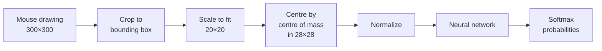

<div align="center">

# ✍️ MNIST Digit Painter

**Draw a digit. Watch a neural network guess it, live.**


<!-- Replace with a screenshot or GIF of the app -->
<!--  -->

</div>

---

## ✨ Features

- 🎨 **Draw with your mouse** on a smooth, anti-aliased canvas
- ⚡ **Live predictions** at about 30 updates per second while you draw
- 📊 **Animated probability bars** for all ten digits, with the winner highlighted
- 🔍 **Model input preview** that shows the exact 28×28 image the network sees
- ↩️ **Undo** up to 30 strokes, adjustable brush size
- 🌙 **Dark, modern UI** built with PySide6 (Qt 6)
- 🧠 **Works with your own model**: whole saved models, plain MLP state dicts, or CNNs (see below)

## 🚀 Quick start

```bash
git clone https://github.com/<your-username>/<your-repo>.git
cd <your-repo>

pip install PySide6 torch numpy

python GUI/mnist_paint.py
```

The app loads the model from `./mnist_Number_Image_model.pth`, relative to the script. If your files live elsewhere, change `MODEL_PATH` at the top of `mnist_paint.py`.

## ⌨️ Controls

| Action | Input |
|---|---|
| Draw | Left mouse button |
| Clear canvas | `C` or `Esc` |
| Undo last stroke | `Ctrl + Z` |
| Smaller / larger brush | `[` / `]` |

## 🧪 How it works

Raw drawings look different from the MNIST dataset, so the app converts them the same way the original digits were made before they reach the network:



This centering step makes a big difference in accuracy on hand-drawn input.

## 🧠 Using your own model

The loader handles the common cases automatically:

| Your `.pth` contains | What happens |
|---|---|
| A whole model (`torch.save(model, ...)`) | Loaded directly |
| A state dict of a plain MLP | Network rebuilt from the weight shapes |
| A state dict of a CNN | Edit the `MyCNN` class in `mnist_paint.py` so it matches your training code |

If you trained **without** normalization, set `NORMALIZE = None` at the top of the file. The default is the standard MNIST `(0.1307, 0.3081)`.

## 📁 Project structure

```
.
├── Number Guessr/
   └── mnist_paint.py          # the app
   └── mnist_Number_Image_model.pth
   └── README.md
   └── ModelTrain.ipynb
```

## 📈 Results

My model reaches **97% accuracy** on the MNIST test set.

## 📄 License

None, a star is appreciated ⭐
